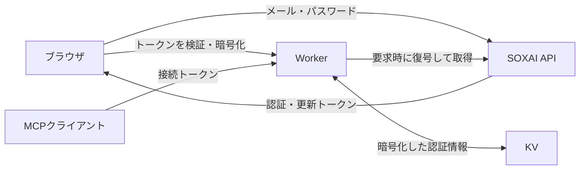

# リモートMCPの接続・運用ガイド

## 接続して使う

[READMEの共通手順](../README.md#接続する)に従い、MCPクライアントへ `https://soxai-mcp.fjm2u.net/mcp` を登録します。接続方式はStreamable HTTP、認証はOAuthです。DCRまたはCIMDに対応したクライアントでは、Client ID・Secretの手入力は不要です。

認証はブラウザで行い、完了後は接続元のアプリへ戻ります。接続したアカウント自身のデータだけを取得します。接続先アプリのツール一覧に `get_health_data` が表示されることを確認してください。
`no_data` は接続失敗ではなく、対象期間に測定データがない状態です。

トークンは自動更新します。接続が切れた場合は、利用中のアプリのMCP／コネクタ設定から再接続してください。接続画面が期限切れになった場合も、接続元のアプリから開始し直してください。

対応する認可先はHTTPS、またはHTTPループバック（localhost・127.0.0.1・::1）です。独自URIスキーム、外部ホストへのHTTPリダイレクトは未対応です。各アプリのリモートMCP・OAuth対応、プラン、管理者設定も確認してください。

取得期間や日付・単位の扱いは[データ仕様](data-contract.md)を参照してください。

## 自分のCloudflareへ配置する

以下はサーバーを自分で運用する場合の手順です。接続先のMCPクライアントから到達できるHTTPSエンドポイントが必要です。

Node.js 24、Cloudflareアカウントを用意します。Plugin ZIPを作成する場合のみPython 3.11以上も使用します。
WorkersがMCPとOAuthを提供し、KVに接続トークンで保護したSOXAI認証情報、D1に短期間の接続手続き情報を保存します。
使用量はCloudflareの料金・上限に従います。

```sh
cd web
npm ci
npx wrangler login
npx wrangler d1 create soxai-ring-mcp
npx wrangler kv namespace create OAUTH_KV
cp wrangler.jsonc wrangler.local.jsonc
```

`wrangler.local.jsonc` のDB・KVのIDと `PUBLIC_URL` を、自分のCloudflare環境に合わせます。
`PUBLIC_URL` は `https://soxai-ring-mcp.<自分のサブドメイン>.workers.dev` です。末尾の `/` は付けません。
このファイルはGit管理対象外です。

次の値を `wrangler secret put` の対話入力で保存します。シークレットをGitやチャットに貼らないでください。

| Secret | 値 |
| --- | --- |
| `ENCRYPTION_KEY` | 接続手続き情報の保護とレート制限用。ランダムな32バイトをBase64にした値。例: `openssl rand -base64 32` |

```sh
npx wrangler secret put ENCRYPTION_KEY --config wrangler.local.jsonc
npx wrangler d1 execute soxai-ring-mcp --remote --config wrangler.local.jsonc --file schema.sql
npm run check
npm test
npx wrangler deploy --config wrangler.local.jsonc
```

独自ドメインを使う場合は `PUBLIC_URL` をそのHTTPS URLにして、Wranglerの `routes` に `custom_domain: true` のホスト名を追加します。

配置後は「接続して使う」のURLを `https://<配置先>/mcp` に置き換えて追加します。
OAuthの動的クライアント登録に対応し、認可コードにはPKCE（S256）が必須です。
クライアント別の `REDIRECT_URIS` 設定は不要です。DCRまたはCIMDで登録されたURIをOAuthライブラリが検証します。HTTPSとHTTPループバックを認可先として受け付け、外部HTTP・フラグメント・ユーザー情報付きURIは拒否します。CIMD取得は `global_fetch_strictly_public` により公開ネットワークに制限します。

## ChatGPT Pluginに分析用Skillを追加する（任意）

この節はChatGPT固有の追加機能です。通常のMCP接続には不要です。

作成したPluginの **⋯ → Download plugin ZIP** でZIPを保存します。
接続の識別子を保ったまま、同梱の分析用Skillを追加します。

```sh
python3 package_plugin.py ~/Downloads/plugin.zip ./soxai-ring-plugin.zip
```

同じPluginの **⋯ → Upload new version** から作成したZIPをアップロードします。
詳細に **Apps 1 / Skills 1** が表示されれば完了です。Marketplaceの追加や公開申請は不要です。
ZIPには接続の識別子だけを含め、OAuthシークレットやSOXAI認証情報を含めません。

## 認証情報の保護

メールアドレス・パスワードはブラウザからSOXAI APIへ直接送信し、Workerは受け取りません。SOXAIから返ったトークンをWorkerで検証した後、OAuth接続を発行します。ブラウザの永続ストレージには保存しません。



`@cloudflare/workers-oauth-provider` の暗号化機構を使用します。認可中はコードで保護し、コード交換後は次の2つに分けます。

| MCPクライアントが保持するもの | 復号できるSOXAI認証情報 | 有効期間 |
| --- | --- | --- |
| アクセストークン | SOXAIアクセストークン・UID・期限 | 最大15分、SOXAIの期限より60秒以上短い |
| 更新トークン | SOXAI更新トークン・UID | 接続から最大30日 |

認証情報をAES-GCMで暗号化し、接続トークンから導出した鍵で暗号鍵をラップします。KVに接続トークンの平文は保存しません。共通のサーバー鍵だけではSOXAI認証情報を復号できません。ただし、Workerは要求時に復号するため、稼働中のサーバー侵害に対するエンドツーエンド暗号化ではありません。

MCPクライアントから更新要求を受けるたびにSOXAIトークンも更新し、同一UIDであることを検証して暗号化情報を入れ替えます。一時的なSOXAI障害では接続を消さず再試行可能なエラーを返します。失効やUIDの不一致では更新を拒否し、再接続を求めます。

健康データ・パスワードは保存しません。D1には10分間の接続手続き情報とレート制限用の一時的な識別値のみを保存します。期限切れD1行の物理削除は次の認証関連リクエスト時です。KVのトークン・認可には有効期限を設定しますが、クライアント登録は自動削除しません。

クライアント側の接続解除とOAuthの失効処理は区別されます。失効要求を受ければ該当の認可を削除しますが、KVの反映遅延やクライアント側の動作があるため即時の完全消去は保証しません。運用終了時はWorker、専用D1、専用KV、シークレットを削除してください。
